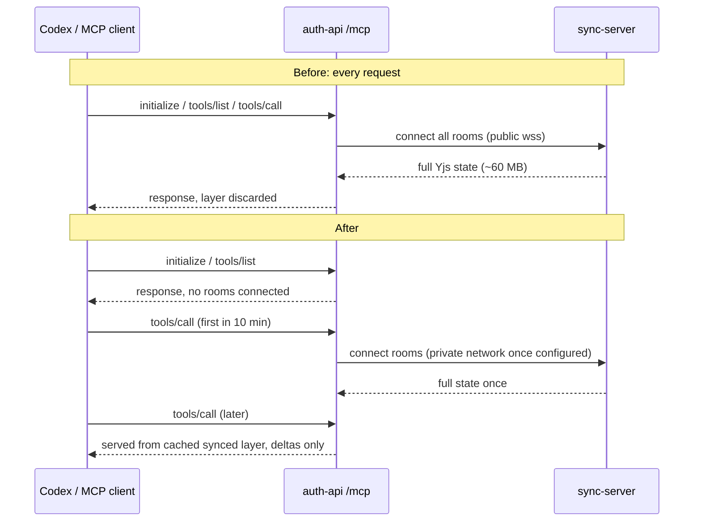

# Sync-Server Egress Clamp (2026-11-05)

## Goal

Stop the hosted MCP endpoint from re-downloading every room on every MCP
request, and move auth-api to sync-server traffic off billed public egress.

## Evidence (measured, Railway dashboard, 2026-11-05)

- Oct 4 - Nov 4 bill: sync-server public egress 765.86 GB ($38.29) of a
  $50.23 bill. Sync-server ingress was near zero.
- auth-api public **ingress** has the same shape and peak size (about 40 GB
  per chart bucket) as sync-server egress. The bytes leave sync-server and
  arrive at auth-api over the public domain.
- auth-api `mcp-route` log volume matches the egress shape: light Oct 6-9,
  heavy Oct 19-30, near zero Oct 31 - Nov 4, active again Nov 5.
- Nov 5, 6-hour sync-server view: egress arrives in separate spikes of about
  180 MB. Each spike lines up with a group of 3 MCP requests about 4 s apart
  (one Codex session start: `initialize`, `notifications/initialized`,
  `tools/list`). That is about 60 MB per MCP request.
- sync-server volume holds about 150-250 MB of SQLite in total, so one user's
  rooms at about 60 MB is consistent.
- 765 GB / 60 MB is about 12,700 full room downloads in the month.

## Cause (code)

- `routes/mcp.ts` creates `WebStandardStreamableHTTPServerTransport()` with no
  `sessionIdGenerator`, so the transport is stateless and clients never get an
  `mcp-session-id`. The session cache was never hit.
- Every request built a new `DataLayer` and called `init()`, which connects to
  every room in the token's scope and waits for a full Yjs sync from an empty
  `Y.Doc`. Then the request disposed it.
- `MCP_INTERNAL_SYNC_URL` was not pointing at the private network, so the sync
  went over `sync.eweser.com` and was billed as public egress.

## Changes

1. `auth-server-hono/src/routes/mcp.ts`
   - Requests with no `tools/call` or `resources/read` message build an
     un-initialised `DataLayer`, so they connect no rooms.
   - Room-data requests reuse a cached, still-subscribed `DataLayer` keyed by
     token hash plus a fingerprint of agent config and room IDs. Idle layers
     are pruned after 10 minutes, rebuilt after 30 minutes, and at most 25
     are kept. A scope change makes a
     new key, so stale scopes are not served.
   - The old cache was keyed by a client-supplied `mcp-session-id` alone. It
     is now also bound to the token hash.
   - The request log records `roomData`, `cachedLayer` and `roomCount`.
2. `sync-server/src/index.ts`: `SYNC_HOST` bind address (default unchanged,
   `0.0.0.0`). Railway needs `::` for `*.railway.internal`.
3. `docs/deployment/railway.md`: private-network settings.

## Expected effect

- Session starts: 3 full downloads to 0. About two thirds of the traffic.
- Tool calls: one full download per token per 10 idle minutes instead of one
  per call.
- With `SYNC_HOST=::` and `MCP_INTERNAL_SYNC_URL` on the private network, the
  remaining auth-api to sync-server bytes have no egress fee.

## Production steps (need Jacob's approval; not done)

1. Merge (Railway auto-deploys auth-api and sync-server).
2. sync-server: `SYNC_HOST=::`. auth-api:
   `MCP_INTERNAL_SYNC_URL=ws://sync-server.railway.internal:<PORT>`.
3. Verify one MCP tool call works, then check sync-server egress stays flat.

Rollback: remove the two variables (public path resumes); revert the PR.

## Verification Gaps

- No live per-request byte count; the 60 MB figure comes from chart spikes.
- Sync-server shows many 4xx HTTP requests (about 85% of 1.1K in 6 hours).
  They carry little traffic; their source is not identified.
- Memory: a cached layer keeps one user's rooms in auth-api memory for up to
  10 idle minutes.
